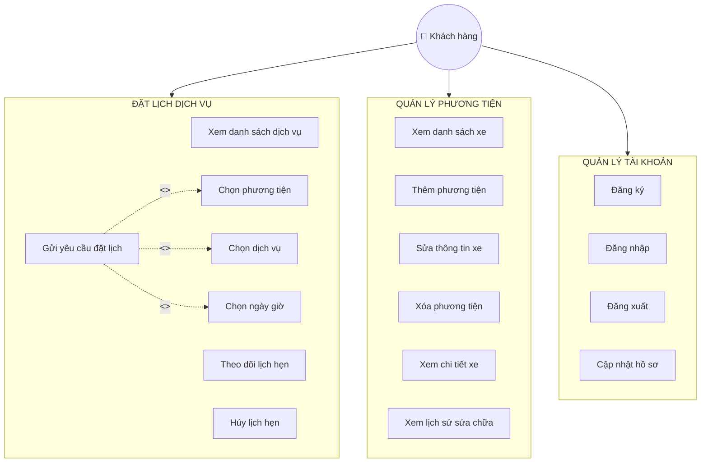
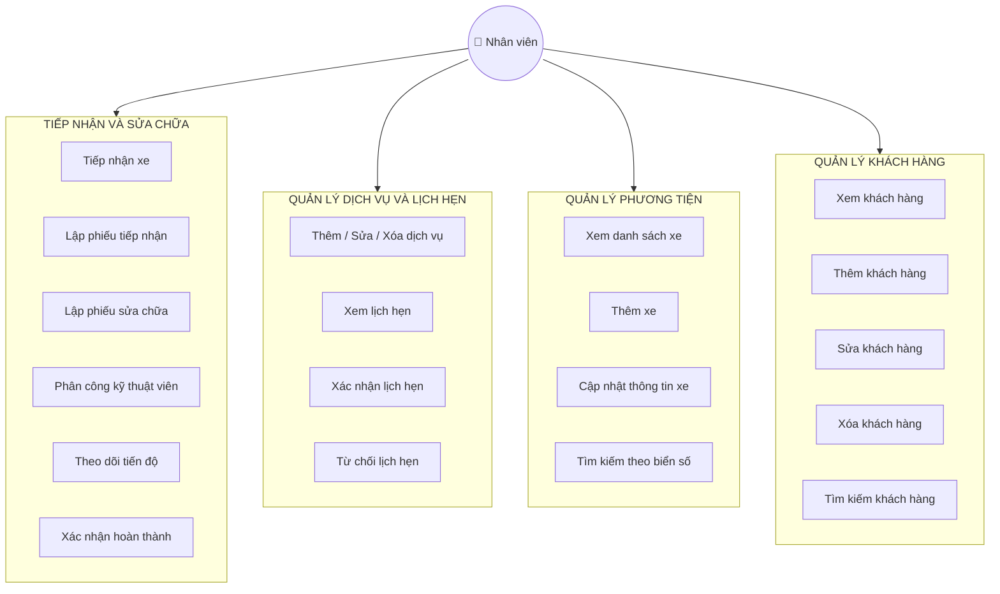
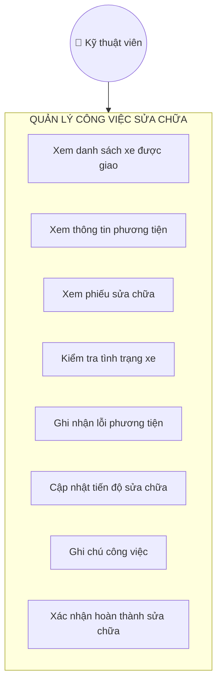
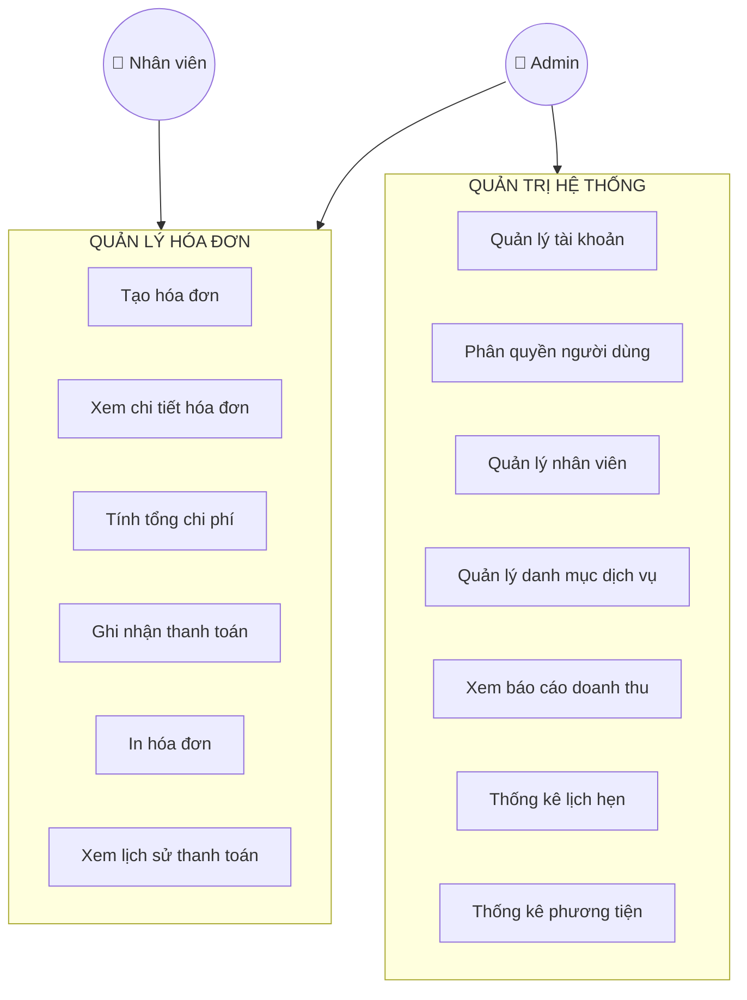
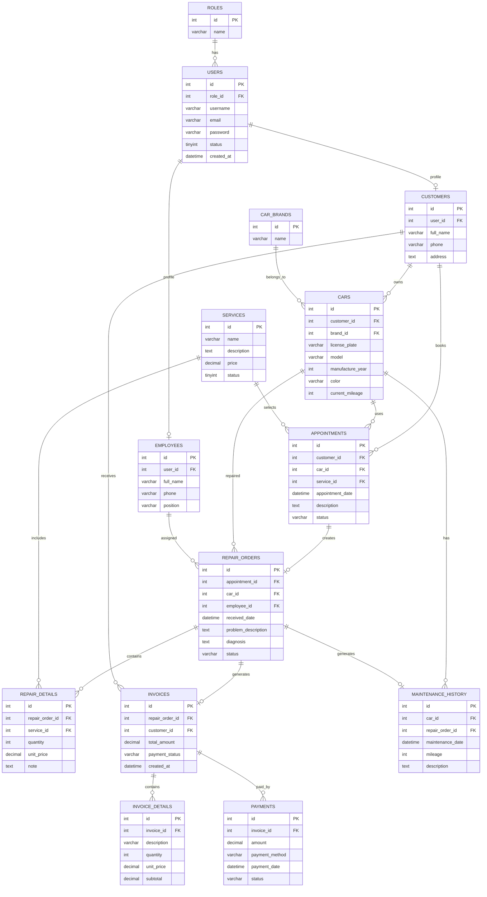

# BẢN THIẾT KẾ NGHỆP VỤ & CƠ SỞ DỮ LIỆU HỆ THỐNG DRIVEHUB
**(Hệ thống Quản lý Gara Ô tô)**

---

## 1. Sơ đồ Use Case tổng quát

Hệ thống có **4 tác nhân chính**:
* **Admin**: Quản lý toàn bộ hệ thống, phân quyền và xem báo cáo thống kê.
* **Nhân viên**: Tiếp nhận xe, quản lý lịch hẹn, lập phiếu và quản lý hóa đơn.
* **Kỹ thuật viên**: Kiểm tra, sửa chữa phương tiện và cập nhật tiến độ.
* **Khách hàng**: Quản lý thông tin xe, đặt lịch hẹn dịch vụ và theo dõi quá trình sửa chữa.

```mermaid
graph TD
    subgraph DriveHub["DRIVEHUB - HỆ THỐNG QUẢN LÝ GARA"]
        %% Common Use Cases
        UC_Auth["Đăng ký / Đăng nhập"]
        UC_Profile["Quản lý hồ sơ cá nhân"]

        %% Customer Use Cases
        UC_CustomerVehicles["Quản lý phương tiện"]
        UC_ViewServices["Xem dịch vụ"]
        UC_BookAppt["Đặt lịch sửa chữa"]
        UC_TrackAppt["Theo dõi lịch hẹn"]
        UC_History["Xem lịch sử sửa chữa"]

        %% Employee Use Cases
        UC_ManageCustomers["Quản lý khách hàng"]
        UC_ManageVehicles["Quản lý phương tiện"]
        UC_ManageServices["Quản lý dịch vụ"]
        UC_ManageAppts["Quản lý lịch hẹn"]
        UC_ReceiveCar["Tiếp nhận phương tiện"]
        UC_RepairTicket["Lập phiếu sửa chữa"]
        UC_AssignTech["Phân công kỹ thuật viên"]
        UC_Invoice["Quản lý hóa đơn"]
        UC_Payment["Ghi nhận thanh toán"]

        %% Tech Use Cases
        UC_TrackProgress["Cập nhật tiến độ sửa chữa"]

        %% Admin Use Cases
        UC_AdminUsers["Quản lý tài khoản và phân quyền"]
        UC_Reports["Xem báo cáo thống kê"]
    end

    %% Actors
    Customer(("👤 Khách hàng"))
    Staff(("👤 Nhân viên"))
    Tech(("👤 Kỹ thuật viên"))
    Admin(("👤 Admin"))

    %% Customer Links
    Customer --> UC_Auth
    Customer --> UC_Profile
    Customer --> UC_CustomerVehicles
    Customer --> UC_ViewServices
    Customer --> UC_BookAppt
    Customer --> UC_TrackAppt
    Customer --> UC_History

    %% Staff Links
    Staff --> UC_Auth
    Staff --> UC_ManageCustomers
    Staff --> UC_ManageVehicles
    Staff --> UC_ManageServices
    Staff --> UC_ManageAppts
    Staff --> UC_ReceiveCar
    Staff --> UC_RepairTicket
    Staff --> UC_AssignTech
    Staff --> UC_Invoice
    Staff --> UC_Payment

    %% Tech Links
    Tech --> UC_Auth
    Tech --> UC_TrackProgress

    %% Admin Links
    Admin --> UC_Auth
    Admin --> UC_AdminUsers
    Admin --> UC_Reports
```

---

## 2. Sơ đồ Use Case phân rã

### 2.1. Phân rã chức năng Khách hàng
Sơ đồ mô tả chi tiết các tác vụ mà Khách hàng có thể thực hiện trên ứng dụng:

---

### 2.2. Phân rã chức năng Quản lý Gara (Nhân viên)
Sơ đồ bóc tách các nghiệp vụ tiếp nhận xe, điều phối công việc và quản lý danh mục của Nhân viên:

---

### 2.3. Phân rã chức năng Kỹ thuật viên
Sơ đồ tập trung vào quy trình xử lý kỹ thuật của Kỹ thuật viên sau khi nhận xe:

---

### 2.4. Phân rã chức năng Admin và Hóa đơn
Sơ đồ thể hiện luồng quản lý doanh thu, hóa đơn cũng như phân quyền hệ thống của Admin & Nhân viên:

---

## 3. Sơ đồ ERD – Entity Relationship Diagram

Mô hình thực thể liên kết gồm **14 bảng dữ liệu chính** được thiết kế chuẩn hóa:

---

## 4. Giải thích các mối quan hệ quan trọng

| Bảng nguồn | Bảng đích | Mối quan hệ | Ý nghĩa nghiệp vụ |
| :--- | :--- | :---: | :--- |
| **ROLES** | **USERS** | 1 – N | Một vai trò (Admin, Nhân viên, Tech, Khách) áp dụng cho nhiều tài khoản người dùng. |
| **USERS** | **CUSTOMERS** | 1 – 1 | Mỗi tài khoản Khách hàng liên kết trực tiếp tới 01 hồ sơ khách hàng. |
| **USERS** | **EMPLOYEES** | 1 – 1 | Mỗi tài khoản Nhân viên/Kỹ thuật viên liên kết tới 01 hồ sơ nhân viên. |
| **CUSTOMERS** | **CARS** | 1 – N | Một khách hàng có thể đăng ký và sở hữu nhiều phương tiện. |
| **CARS** | **APPOINTMENTS** | 1 – N | Một xe có thể được tạo nhiều lịch hẹn bảo dưỡng/sửa chữa theo thời gian. |
| **APPOINTMENTS** | **REPAIR_ORDERS** | 1 – 1 | Một lịch hẹn được duyệt sẽ chuyển thành 01 phiếu sửa chữa chính thức. |
| **EMPLOYEES** | **REPAIR_ORDERS** | 1 – N | Một nhân viên/kỹ thuật viên chính có thể phụ trách nhiều phiếu sửa chữa. |
| **REPAIR_ORDERS** | **REPAIR_DETAILS** | 1 – N | Một phiếu sửa chữa bao gồm nhiều hạng mục công việc/dịch vụ chi tiết. |
| **REPAIR_ORDERS** | **INVOICES** | 1 – 1 | Mỗi phiếu sửa chữa hoàn thành xuất tối đa 01 hóa đơn tổng. |
| **INVOICES** | **PAYMENTS** | 1 – N | Một hóa đơn có thể được thanh toán qua 01 hoặc nhiều đợt/phương thức. |

> **💡 Lưu ý mở rộng:** 
> * Để cho phép 1 phiếu sửa chữa được thực hiện bởi nhiều kỹ thuật viên cùng lúc, nhóm có thể bổ sung bảng trung gian `REPAIR_ASSIGNMENTS (repair_order_id, employee_id, role)`.

---

## 5. Đánh giá & Góp ý kiến trúc hệ thống

1. **Về Sơ đồ Use Case**:
   * Kiến trúc phân quyền 4 nhóm tác nhân rất rõ ràng. Các chức năng quan trọng (Đặt lịch, Tiếp nhận, Thanh toán) đều có tính nối tiếp hợp logic nghiệp vụ gara ô tô thực tế.
   * *Đề xuất*: Khi hiện thực hóa API/UI, nên ép buộc kiểm tra token xác thực (`<<include>> Đăng nhập`) đối với tất cả các Use Case có ghi nhận dữ liệu vào cơ sở dữ liệu.

2. **Về Cơ sở dữ liệu (ERD)**:
   * **Bảng APPOINTMENTS**: Đang lưu `service_id` đơn (1-N với SERVICES). Nếu khách hàng muốn đăng ký nhiều dịch vụ trên 1 lịch hẹn, nhóm nên xem xét chuyển quan hệ này thành bảng trung gian `APPOINTMENT_SERVICES` để tối ưu trải nghiệm người dùng.
   * **Bảng REPAIR_DETAILS**: Đã có sẵn giá và số lượng, rất tốt để ghi nhận phí lao động hoặc vật tư thay thế.
   * **Bảng MAINTENANCE_HISTORY**: Có thể cập nhật tự động bằng DB Trigger hoặc xử lý ở tầng Service Layer sau khi `REPAIR_ORDERS` chuyển trạng thái sang `COMPLETED`.

---

## 6. Phân công công việc thực hiện

| Thành viên | Nhiệm vụ chính |
| :---: | :--- |
| **TV1** | Thiết kế & rà soát ERD, tối ưu các khóa chính (PK), khóa ngoại (FK) và kiểu dữ liệu. |
| **TV2** | Phân rã và vẽ chi tiết Use Case Quản lý khách hàng, Quản lý phương tiện. |
| **TV3** | Phân rã Use Case Đặt lịch hẹn, Tiếp nhận xe và Quy trình sửa chữa. |
| **TV4** | Phân rã Use Case Hóa đơn, Thanh toán, Báo cáo và Giao diện người dùng. |
| **Cả nhóm** | Kiểm tra tính nhất quán giữa Use Case & ERD trước khi tiến hành viết code/tạo DB. |

---

## 7. Tiêu chí hoàn thành tài liệu
- [x] Có đầy đủ 01 sơ đồ Use Case tổng quát.
- [x] Có đầy đủ 04 sơ đồ Use Case phân rã chi tiết.
- [x] Có 01 sơ đồ ERD chuẩn hóa gồm 14 bảng dữ liệu.
- [x] Tên chức năng trên sơ đồ đồng bộ với tên các bảng trong Database.
- [x] Thiết kế đúng quan hệ 1–1, 1–N và đầy đủ PK/FK.